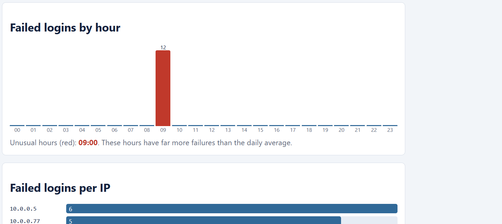

# log-checker


A Python tool that reads login logs, detects attack patterns, and shows the results in the terminal or on a web dashboard. It can also watch a log file in real time.



## What it detects

| Detector | What it finds |
| --- | --- |
| Brute force | Many failed logins from one IP inside a short time window |
| Password spraying | One IP failing against many different accounts |
| Success after failures | A login that works after a streak of failures from the same IP |

It also uses pandas to find hours with unusually many failed logins (a z-score above 2) and to list the most targeted accounts.

## Features

- Command-line analyzer with text and JSON output
- Web dashboard: upload a log, see alerts and charts
- Upload history in SQLite, with repeat offenders across uploads
- Live mode: watch a log file as it grows and alert as attacks happen
- Fake log generator and real-time simulator for testing
- Tests, linting and formatting checked on every push with GitHub Actions

## Setup (Windows)

```
git clone https://github.com/Bonclay-08/log-checker.git
cd log-checker
python -m venv .venv
.venv\Scripts\activate
pip install -r requirements-dev.txt
pip install -e .
```

On macOS or Linux, activate with `source .venv/bin/activate` instead.

## Usage

Log lines use this format, one login attempt per line:

```
2026-11-25 09:15:01 FAILED admin 10.0.0.5
2026-11-25 09:15:20 SUCCESS grace 10.0.0.12
```

Lines that do not match are skipped.

Analyze a log in the terminal:

```
python -m myapp data\sample.log
python -m myapp data\sample.log --json
python -m myapp data\sample.log --max-failures 10 --window 30
```

Generate a test log with hidden attacks, then look at failures by hour:

```
python -m myapp.generate
python -m myapp.analysis data\generated.log
```

Start the web dashboard at http://127.0.0.1:5000:

```
python -m myapp.web
```

### Live mode

Run these in two terminals. The simulator writes fake logins to `data\live.log`, and the monitor prints alerts as attacks appear:

```
python -m myapp.simulate
python -m myapp.live data\live.log
```

With the web server running, http://127.0.0.1:5000/live shows the same alerts in the browser and updates every 2 seconds.

## Project layout

```
src/myapp/
    logs.py       parse log lines into events
    detect.py     the three detectors
    report.py     build text and JSON reports
    analysis.py   pandas analysis (failures by hour)
    db.py         SQLite upload history
    live.py       follow a file and alert in real time
    livefeed.py   background feed for the live web page
    web.py        Flask dashboard
    generate.py   fake log generator
    simulate.py   real-time log simulator
    cli.py        command-line interface
tests/            pytest tests
data/             sample log
```

## Development

```
ruff format .
ruff check .
python -m pytest
```

## Notes

- The web server only listens on your own computer (127.0.0.1) and limits uploads to 2 MB.
- Database queries use placeholders to prevent SQL injection, and the live page never inserts log data as HTML.
- Only the log format above is supported. Real systems such as Linux SSH logs or Windows Event logs would each need their own parser.